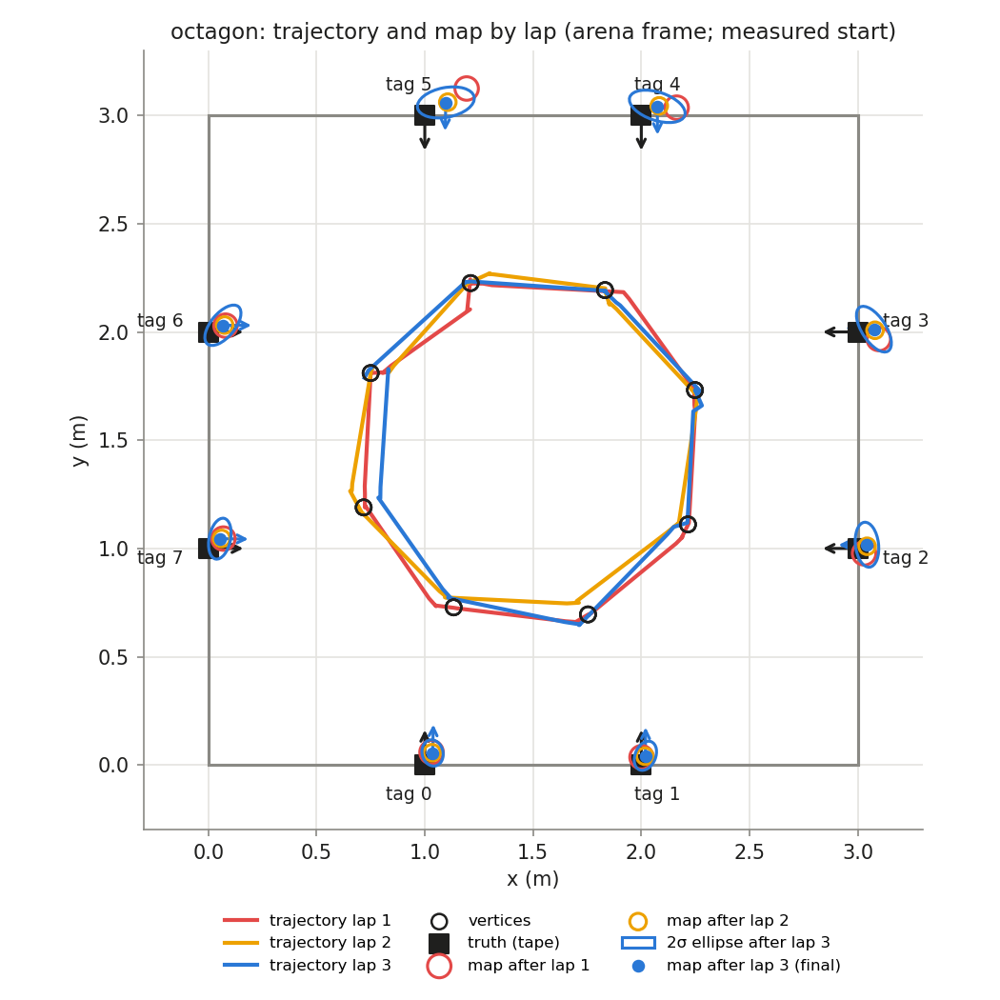
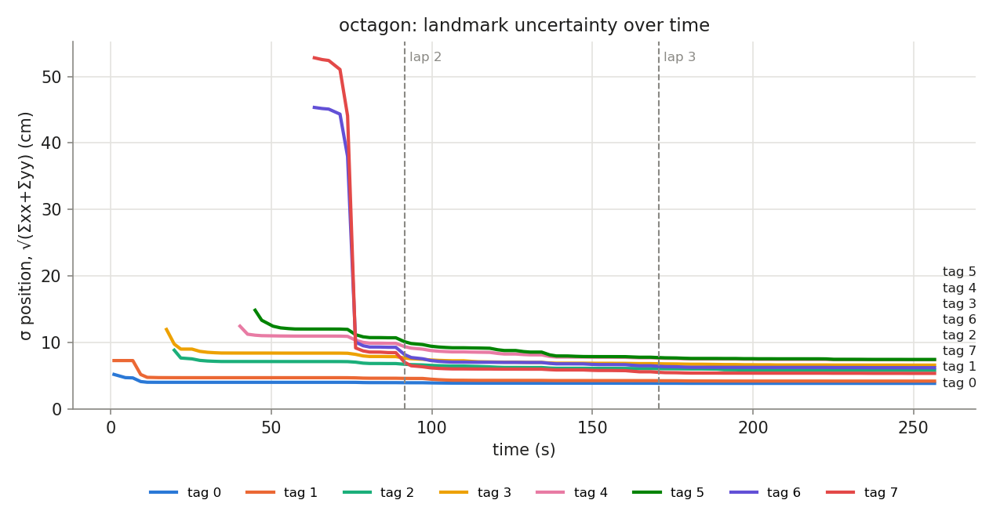

## Phase `octagon`

- vertices reached: 24/24; motion: 13.88 m driven, 1282° turned, 41 drives + 34 spins

### Final map vs truth

Placement in the arena: measured start (0.750, 1.810, -93.0°)

| tag | estimate (arena) | truth | 2σ ellipse (cm) | error, measured start (cm) | error, rigid fit (cm) | ψ error (°) |
|---|---|---|---|---|---|---|
| 0 | (1.036, 0.055, +88.4°) | (1.000, 0.000, +90.0°) | 6.1 × 4.8 | 6.6 | 1.0 | -1.6 |
| 1 | (2.019, 0.042, +89.5°) | (2.000, 0.000, +90.0°) | 7.0 × 4.7 | 4.6 | 2.1 | -0.5 |
| 2 | (3.042, 1.017, -179.4°) | (3.000, 1.000, +180.0°) | 10.4 × 5.3 | 4.6 | 0.8 | +0.6 |
| 3 | (3.074, 2.013, +177.6°) | (3.000, 2.000, +180.0°) | 12.1 × 5.6 | 7.5 | 1.0 | -2.4 |
| 4 | (2.074, 3.042, -89.5°) | (2.000, 3.000, -90.0°) | 13.4 × 6.5 | 8.5 | 1.2 | +0.5 |
| 5 | (1.097, 3.060, -91.5°) | (1.000, 3.000, -90.0°) | 13.3 × 6.8 | 11.4 | 2.3 | -1.5 |
| 6 | (0.067, 2.031, -0.1°) | (0.000, 2.000, +0.0°) | 11.2 × 5.5 | 7.4 | 2.9 | -0.1 |
| 7 | (0.053, 1.045, -0.9°) | (0.000, 1.000, +0.0°) | 9.6 × 4.9 | 7.0 | 1.4 | -0.9 |

- **mean error, measured start: 7.2 cm** (rms 7.5, max 11.4 cm, mean |ψ| 1.0°)
- **mean error, best rigid fit: 1.6 cm** (rms 1.8, max 2.9 cm, mean |ψ| 0.8°)
- mean error after rigid fit **with scale**: 1.6 cm; the map is **0.999×** the truth (a uniform scale error, e.g. tag size or arena size)

### Lap by lap (lap 1 builds the map; later laps re-observe it)

| lap | landmarks | mean error (cm) | after rigid fit (cm) | mean σ (cm) | looks | update | init | gate | skip_init | mean d² |
|---|---|---|---|---|---|---|---|---|---|---|
| 1 | 8 | 10.1 | 3.9 | 7.2 | 36 | 57 | 8 | 0 | 1 | 0.37 |
| 2 | 8 | 7.6 | 1.8 | 6.1 | 30 | 61 | 0 | 0 | 0 | 0.81 |
| 3 | 8 | 7.2 | 1.6 | 5.9 | 33 | 37 | 0 | 0 | 0 | 0.66 |

### Landmark cases (new / out of view / re-appeared)

| tag | first added (t s, dist m, lap) | skip_init | updates | gated | re-appeared |
|---|---|---|---|---|---|
| 0 | 1.0, 1.79, lap 1 | 0 | 19 | 0 | 4 |
| 1 | 1.0, 2.16, lap 1 | 0 | 19 | 0 | 5 |
| 2 | 19.8, 1.91, lap 1 | 0 | 14 | 0 | 4 |
| 3 | 17.4, 2.39, lap 1 | 0 | 22 | 0 | 6 |
| 4 | 40.2, 2.00, lap 1 | 0 | 21 | 0 | 7 |
| 5 | 45.0, 2.26, lap 1 | 0 | 17 | 0 | 4 |
| 6 | 63.4, 1.85, lap 1 | 0 | 22 | 0 | 8 |
| 7 | 63.4, 2.18, lap 1 | 1 | 21 | 0 | 6 |
