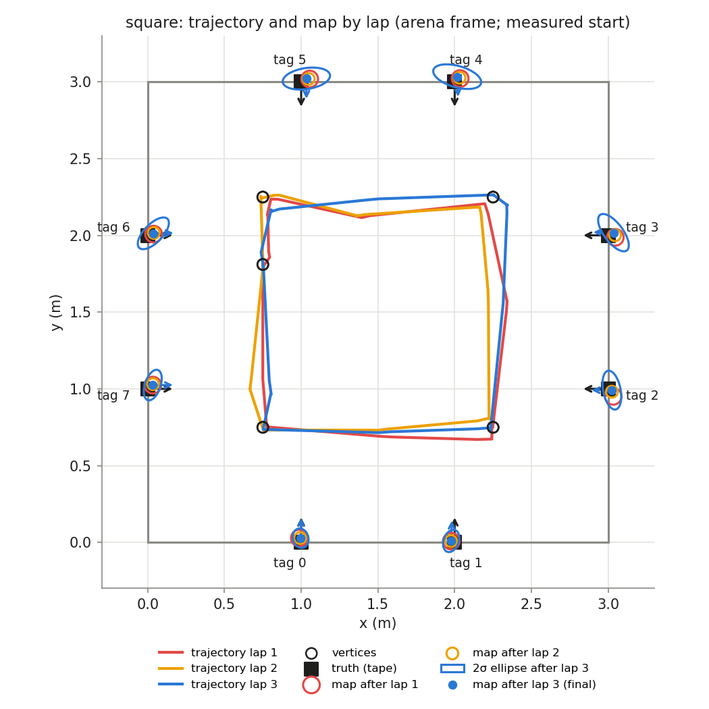
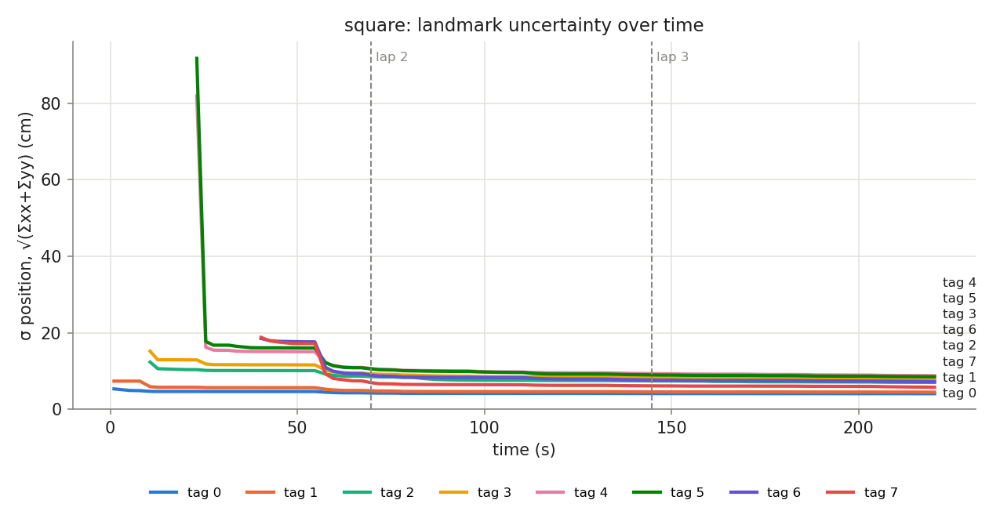

## Phase `square`

- vertices reached: 15/15; motion: 16.08 m driven, 1360° turned, 33 drives + 31 spins

### Final map vs truth

Placement in the arena: measured start (0.750, 1.810, -90.0°)

| tag | estimate (arena) | truth | 2σ ellipse (cm) | error, measured start (cm) | error, rigid fit (cm) | ψ error (°) |
|---|---|---|---|---|---|---|
| 0 | (0.997, 0.027, +88.6°) | (1.000, 0.000, +90.0°) | 6.4 × 5.0 | 2.7 | 1.2 | -1.4 |
| 1 | (1.977, 0.009, +88.2°) | (2.000, 0.000, +90.0°) | 7.5 × 4.9 | 2.5 | 3.0 | -1.8 |
| 2 | (3.024, 0.992, -179.7°) | (3.000, 1.000, +180.0°) | 12.9 × 5.7 | 2.5 | 1.6 | +0.3 |
| 3 | (3.034, 2.017, +178.8°) | (3.000, 2.000, +180.0°) | 14.5 × 6.2 | 3.9 | 1.7 | -1.2 |
| 4 | (2.016, 3.034, -87.6°) | (2.000, 3.000, -90.0°) | 16.1 × 7.0 | 3.8 | 2.6 | +2.4 |
| 5 | (1.034, 3.021, -89.9°) | (1.000, 3.000, -90.0°) | 15.6 × 6.8 | 4.0 | 0.2 | +0.1 |
| 6 | (0.037, 2.013, +0.8°) | (0.000, 2.000, +0.0°) | 13.2 × 6.0 | 3.9 | 2.2 | +0.8 |
| 7 | (0.033, 1.025, +0.0°) | (0.000, 1.000, +0.0°) | 10.4 × 5.1 | 4.1 | 1.9 | +0.0 |

- **mean error, measured start: 3.4 cm** (rms 3.5, max 4.1 cm, mean |ψ| 1.0°)
- **mean error, best rigid fit: 1.8 cm** (rms 1.9, max 3.0 cm, mean |ψ| 1.1°)
- mean error after rigid fit **with scale**: 1.8 cm; the map is **1.000×** the truth (a uniform scale error, e.g. tag size or arena size)

### Lap by lap (lap 1 builds the map; later laps re-observe it)

| lap | landmarks | mean error (cm) | after rigid fit (cm) | mean σ (cm) | looks | update | init | gate | skip_init | mean d² |
|---|---|---|---|---|---|---|---|---|---|---|
| 1 | 8 | 4.3 | 2.1 | 8.0 | 25 | 41 | 8 | 0 | 0 | 0.51 |
| 2 | 8 | 3.9 | 1.7 | 7.1 | 27 | 53 | 0 | 0 | 0 | 0.49 |
| 3 | 8 | 3.4 | 1.8 | 6.7 | 27 | 52 | 0 | 0 | 0 | 0.45 |

### Landmark cases (new / out of view / re-appeared)

| tag | first added (t s, dist m, lap) | skip_init | updates | gated | re-appeared |
|---|---|---|---|---|---|
| 0 | 1.0, 1.81, lap 1 | 0 | 26 | 0 | 4 |
| 1 | 1.0, 2.17, lap 1 | 0 | 19 | 0 | 7 |
| 2 | 10.7, 2.25, lap 1 | 0 | 10 | 0 | 3 |
| 3 | 10.7, 2.58, lap 1 | 0 | 16 | 0 | 5 |
| 4 | 23.1, 2.38, lap 1 | 0 | 15 | 0 | 3 |
| 5 | 23.1, 2.67, lap 1 | 0 | 19 | 0 | 5 |
| 6 | 40.3, 2.15, lap 1 | 0 | 19 | 0 | 3 |
| 7 | 40.3, 2.44, lap 1 | 0 | 22 | 0 | 7 |
