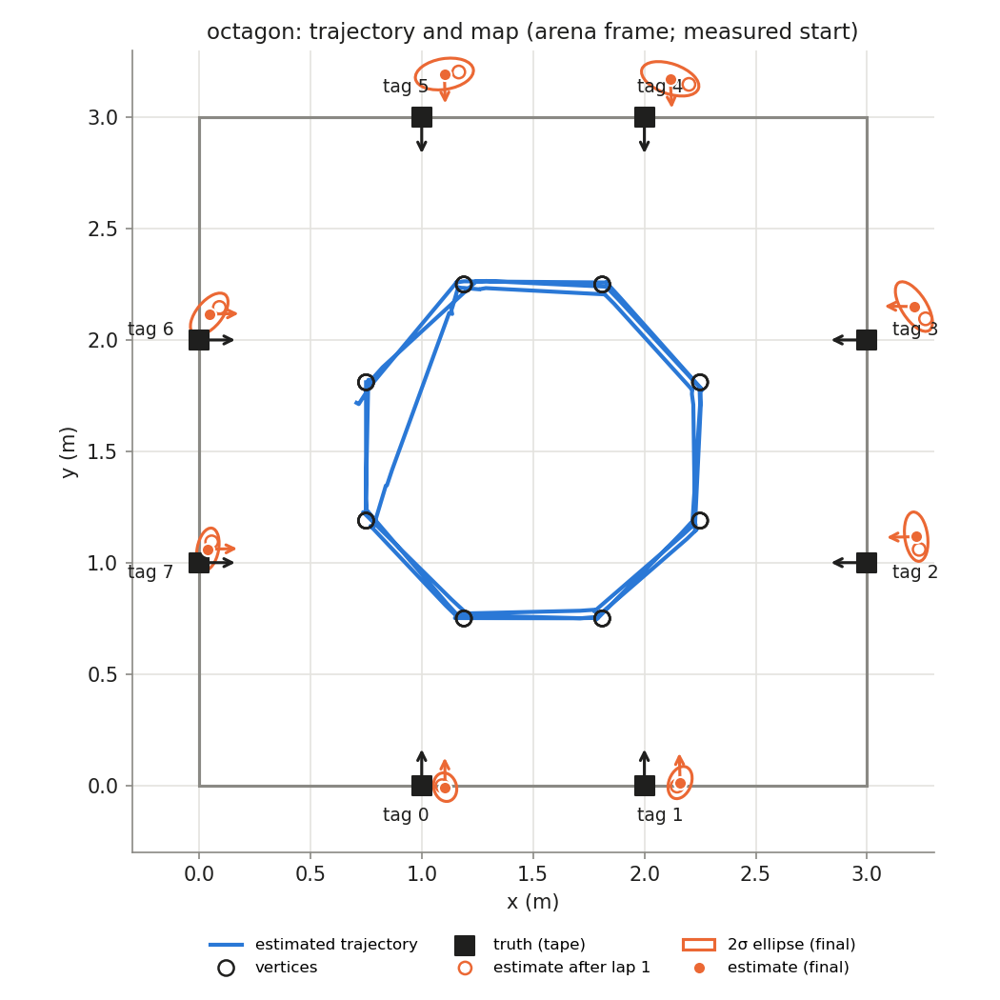
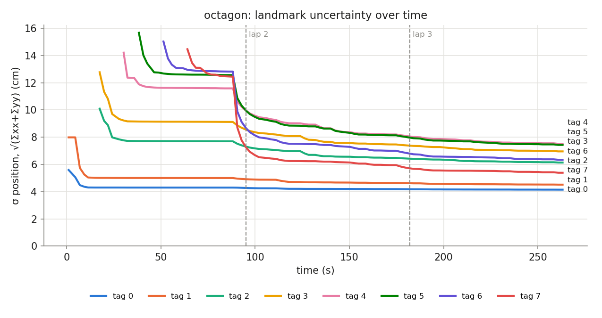

## Phase `octagon`

- vertices reached: 23/24; motion: 13.09 m driven, 1232° turned, 27 drives + 51 spins

### Final map vs truth

Placement in the arena: measured start (0.750, 1.810, -90.0°)

| tag | estimate (arena) | truth | 2σ ellipse (cm) | error, measured start (cm) | error, rigid fit (cm) | ψ error (°) |
|---|---|---|---|---|---|---|
| 0 | (1.105, -0.008, +90.7°) | (1.000, 0.000, +90.0°) | 6.5 × 5.1 | 10.5 | 11.1 | +0.7 |
| 1 | (2.160, 0.012, +91.5°) | (2.000, 0.000, +90.0°) | 7.5 × 5.0 | 16.1 | 9.7 | +1.5 |
| 2 | (3.221, 1.117, -178.7°) | (3.000, 1.000, +180.0°) | 11.1 × 5.1 | 25.0 | 9.1 | +1.3 |
| 3 | (3.210, 2.150, +179.2°) | (3.000, 2.000, +180.0°) | 12.7 × 5.7 | 25.8 | 9.6 | -0.8 |
| 4 | (2.116, 3.173, -86.8°) | (2.000, 3.000, -90.0°) | 13.4 × 6.8 | 20.8 | 6.6 | +3.2 |
| 5 | (1.102, 3.194, -88.5°) | (1.000, 3.000, -90.0°) | 13.2 × 6.9 | 21.9 | 9.8 | +1.5 |
| 6 | (0.046, 2.116, +1.1°) | (0.000, 2.000, +0.0°) | 11.3 × 5.8 | 12.5 | 8.0 | +1.1 |
| 7 | (0.040, 1.060, +1.3°) | (0.000, 1.000, +0.0°) | 9.6 × 4.8 | 7.2 | 9.4 | +1.3 |

- **mean error, measured start: 17.5 cm** (rms 18.6, max 25.8 cm, mean |ψ| 1.4°)
- **mean error, best rigid fit: 9.2 cm** (rms 9.2, max 11.1 cm, mean |ψ| 1.0°)
- mean error after rigid fit **with scale**: 1.6 cm; the map is **1.057×** the truth (a uniform scale error, e.g. tag size or arena size)

### Lap by lap (lap 1 builds the map; later laps re-observe it)

| lap | landmarks | mean error (cm) | after rigid fit (cm) | mean σ (cm) | looks | update | init | gate | skip_init | mean d² |
|---|---|---|---|---|---|---|---|---|---|---|
| 1 | 8 | 19.4 | 9.1 | 7.6 | 38 | 62 | 8 | 0 | 0 | 0.58 |
| 2 | 8 | 18.1 | 9.2 | 6.4 | 33 | 63 | 0 | 0 | 0 | 0.73 |
| 3 | 8 | 17.5 | 9.2 | 6.1 | 31 | 53 | 0 | 0 | 0 | 0.65 |

### Landmark cases (new / out of view / re-appeared)

| tag | first added (t s, dist m, lap) | skip_init | updates | gated | re-appeared |
|---|---|---|---|---|---|
| 0 | 1.0, 1.86, lap 1 | 0 | 26 | 0 | 4 |
| 1 | 1.0, 2.27, lap 1 | 0 | 21 | 0 | 5 |
| 2 | 17.5, 2.08, lap 1 | 0 | 13 | 0 | 3 |
| 3 | 17.5, 2.47, lap 1 | 0 | 21 | 0 | 2 |
| 4 | 30.2, 2.45, lap 1 | 0 | 23 | 0 | 5 |
| 5 | 38.3, 2.33, lap 1 | 0 | 23 | 0 | 3 |
| 6 | 51.3, 2.15, lap 1 | 0 | 24 | 0 | 6 |
| 7 | 64.0, 2.01, lap 1 | 0 | 27 | 0 | 8 |
