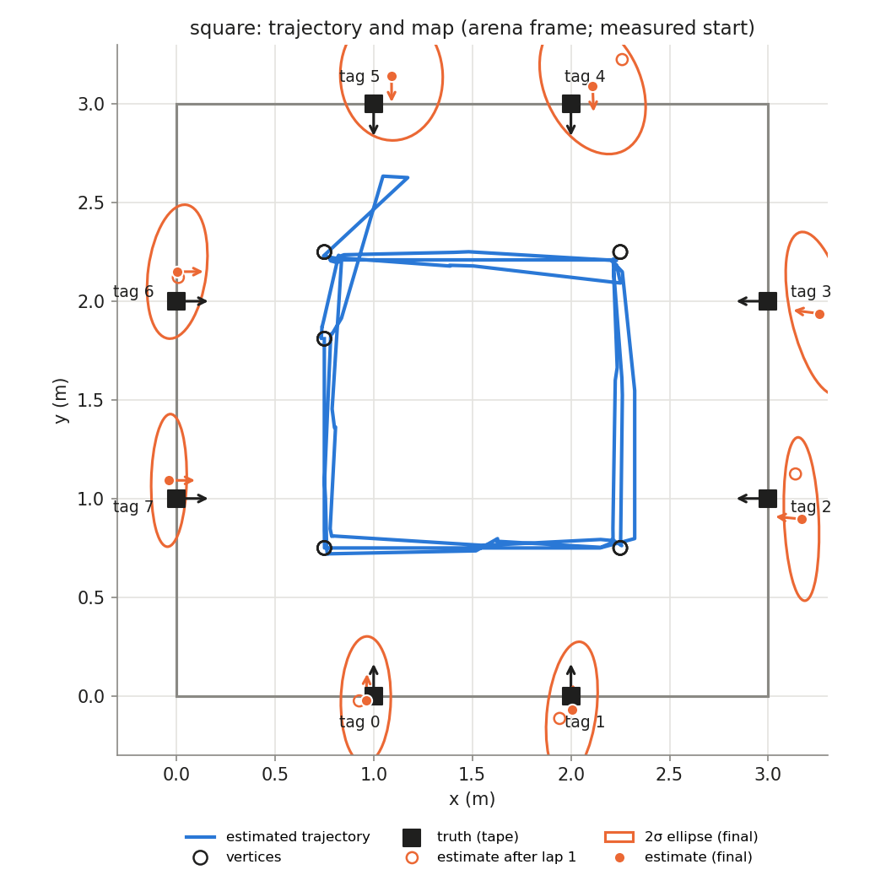
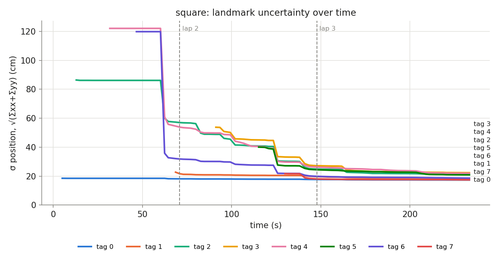
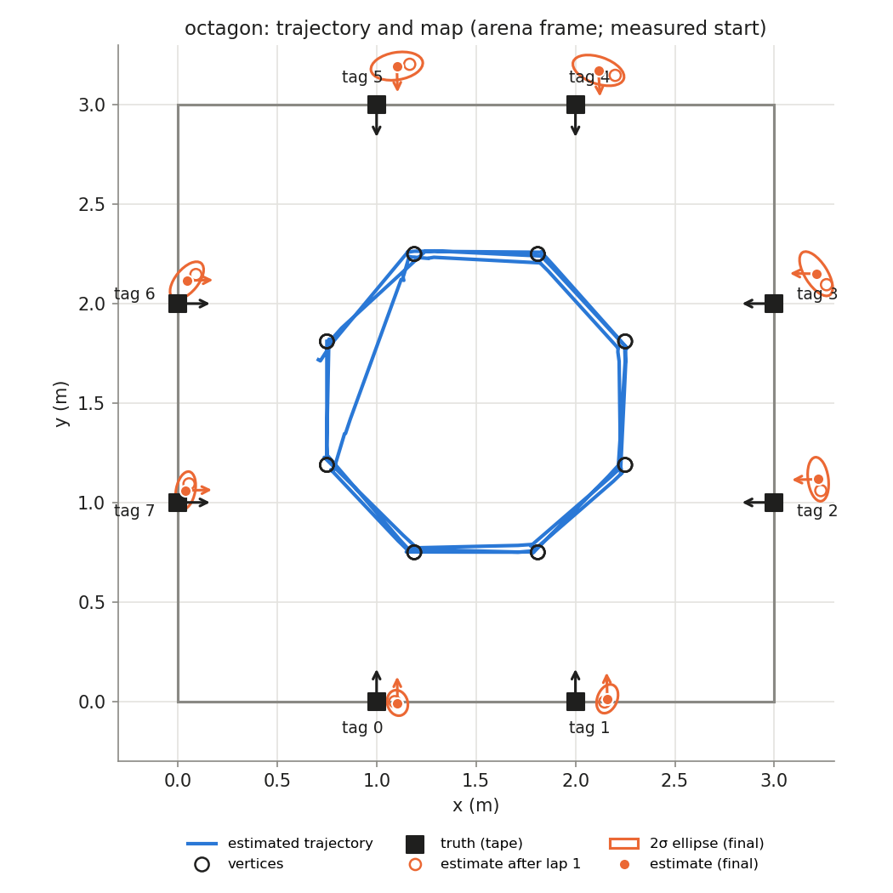
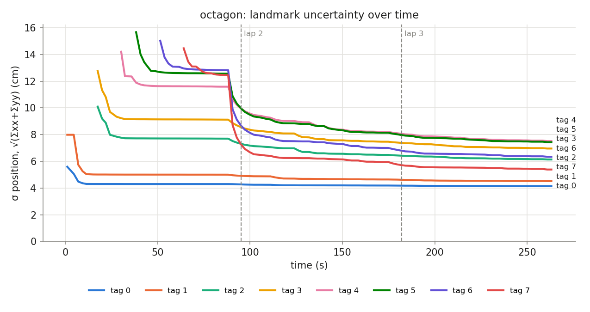

# HW3 run `run_20261106_091125`

## Phase `square`

- vertices reached: 11/15; motion: 16.34 m driven, 1370° turned, 30 drives + 39 spins

### Final map vs truth

Placement in the arena: measured start (0.750, 1.810, -90.0°)

| tag | estimate (arena) | truth | 2σ ellipse (cm) | error, measured start (cm) | error, rigid fit (cm) | ψ error (°) |
|---|---|---|---|---|---|---|
| 0 | (0.960, -0.021, +87.2°) | (1.000, 0.000, +90.0°) | 32.2 × 12.6 | 4.5 | 8.3 | -2.8 |
| 1 | (2.005, -0.072, +87.1°) | (2.000, 0.000, +90.0°) | 34.8 × 12.5 | 7.2 | 7.6 | -2.9 |
| 2 | (3.168, 0.896, +174.7°) | (3.000, 1.000, +180.0°) | 41.4 × 8.8 | 19.8 | 13.7 | -5.3 |
| 3 | (3.258, 1.938, +172.9°) | (3.000, 2.000, +180.0°) | 42.3 × 14.4 | 26.6 | 16.5 | -7.1 |
| 4 | (2.110, 3.092, -88.0°) | (2.000, 3.000, -90.0°) | 36.5 × 24.3 | 14.4 | 9.9 | +2.0 |
| 5 | (1.091, 3.141, -89.8°) | (1.000, 3.000, -90.0°) | 32.6 × 26.0 | 16.8 | 10.7 | +0.2 |
| 6 | (0.005, 2.150, +0.1°) | (0.000, 2.000, +0.0°) | 34.2 × 14.7 | 15.0 | 10.4 | +0.1 |
| 7 | (-0.037, 1.092, +0.0°) | (0.000, 1.000, +0.0°) | 33.6 × 9.0 | 9.9 | 8.5 | +0.0 |

- **mean error, measured start: 14.3 cm** (rms 15.7, max 26.6 cm, mean |ψ| 2.6°)
- **mean error, best rigid fit: 10.7 cm** (rms 11.1, max 16.5 cm, mean |ψ| 2.6°)
- mean error after rigid fit **with scale**: 3.5 cm; the map is **1.065×** the truth (a uniform scale error, e.g. tag size or arena size)

### Lap by lap (lap 1 builds the map; later laps re-observe it)

| lap | landmarks | mean error (cm) | after rigid fit (cm) | mean σ (cm) | looks | update | init | gate | skip_init | mean d² |
|---|---|---|---|---|---|---|---|---|---|---|
| 1 | 5 | 17.1 | 15.4 | 36.5 | 25 | 9 | 5 | 0 | 10 | 0.99 |
| 2 | 8 | 13.0 | 11.6 | 22.2 | 28 | 36 | 3 | 0 | 9 | 1.09 |
| 3 | 8 | 14.3 | 10.7 | 19.8 | 31 | 52 | 0 | 0 | 0 | 0.70 |

### Landmark cases (new / out of view / re-appeared)

| tag | first added (t s, dist m, lap) | skip_init | updates | gated | re-appeared |
|---|---|---|---|---|---|
| 0 | 5.1, 1.10, lap 1 | 0 | 22 | 0 | 3 |
| 1 | 68.6, 2.26, lap 1 | 2 | 13 | 0 | 4 |
| 2 | 12.9, 2.42, lap 1 | 0 | 11 | 0 | 6 |
| 3 | 91.2, 2.05, lap 2 | 5 | 5 | 0 | 1 |
| 4 | 31.8, 1.69, lap 1 | 2 | 16 | 0 | 3 |
| 5 | 115.2, 2.05, lap 2 | 9 | 10 | 0 | 3 |
| 6 | 46.7, 1.64, lap 1 | 0 | 10 | 0 | 2 |
| 7 | 129.9, 1.82, lap 2 | 1 | 10 | 0 | 4 |

## Phase `octagon`

- vertices reached: 23/24; motion: 13.09 m driven, 1232° turned, 27 drives + 51 spins

### Final map vs truth

Placement in the arena: measured start (0.750, 1.810, -90.0°)

| tag | estimate (arena) | truth | 2σ ellipse (cm) | error, measured start (cm) | error, rigid fit (cm) | ψ error (°) |
|---|---|---|---|---|---|---|
| 0 | (1.105, -0.008, +90.7°) | (1.000, 0.000, +90.0°) | 6.5 × 5.1 | 10.5 | 11.1 | +0.7 |
| 1 | (2.160, 0.012, +91.5°) | (2.000, 0.000, +90.0°) | 7.5 × 5.0 | 16.1 | 9.7 | +1.5 |
| 2 | (3.221, 1.117, -178.7°) | (3.000, 1.000, +180.0°) | 11.1 × 5.1 | 25.0 | 9.1 | +1.3 |
| 3 | (3.210, 2.150, +179.2°) | (3.000, 2.000, +180.0°) | 12.7 × 5.7 | 25.8 | 9.6 | -0.8 |
| 4 | (2.116, 3.173, -86.8°) | (2.000, 3.000, -90.0°) | 13.4 × 6.8 | 20.8 | 6.6 | +3.2 |
| 5 | (1.102, 3.194, -88.5°) | (1.000, 3.000, -90.0°) | 13.2 × 6.9 | 21.9 | 9.8 | +1.5 |
| 6 | (0.046, 2.116, +1.1°) | (0.000, 2.000, +0.0°) | 11.3 × 5.8 | 12.5 | 8.0 | +1.1 |
| 7 | (0.040, 1.060, +1.3°) | (0.000, 1.000, +0.0°) | 9.6 × 4.8 | 7.2 | 9.4 | +1.3 |

- **mean error, measured start: 17.5 cm** (rms 18.6, max 25.8 cm, mean |ψ| 1.4°)
- **mean error, best rigid fit: 9.2 cm** (rms 9.2, max 11.1 cm, mean |ψ| 1.0°)
- mean error after rigid fit **with scale**: 1.6 cm; the map is **1.057×** the truth (a uniform scale error, e.g. tag size or arena size)

### Lap by lap (lap 1 builds the map; later laps re-observe it)

| lap | landmarks | mean error (cm) | after rigid fit (cm) | mean σ (cm) | looks | update | init | gate | skip_init | mean d² |
|---|---|---|---|---|---|---|---|---|---|---|
| 1 | 8 | 19.4 | 9.1 | 7.6 | 38 | 62 | 8 | 0 | 0 | 0.58 |
| 2 | 8 | 18.1 | 9.2 | 6.4 | 33 | 63 | 0 | 0 | 0 | 0.73 |
| 3 | 8 | 17.5 | 9.2 | 6.1 | 31 | 53 | 0 | 0 | 0 | 0.65 |

### Landmark cases (new / out of view / re-appeared)

| tag | first added (t s, dist m, lap) | skip_init | updates | gated | re-appeared |
|---|---|---|---|---|---|
| 0 | 1.0, 1.86, lap 1 | 0 | 26 | 0 | 4 |
| 1 | 1.0, 2.27, lap 1 | 0 | 21 | 0 | 5 |
| 2 | 17.5, 2.08, lap 1 | 0 | 13 | 0 | 3 |
| 3 | 17.5, 2.47, lap 1 | 0 | 21 | 0 | 2 |
| 4 | 30.2, 2.45, lap 1 | 0 | 23 | 0 | 5 |
| 5 | 38.3, 2.33, lap 1 | 0 | 23 | 0 | 3 |
| 6 | 51.3, 2.15, lap 1 | 0 | 24 | 0 | 6 |
| 7 | 64.0, 2.01, lap 1 | 0 | 27 | 0 | 8 |

## Square vs octagon (final maps)

| phase | laps | landmarks | mean error (cm) | after rigid fit (cm) | with scale (cm) | map / truth | lap 1 error (cm) | mean σ lap 1 → last (cm) | drive (m) | turns |
|---|---|---|---|---|---|---|---|---|---|---|
| square | 3 | 8 | 14.3 | 10.7 | 3.5 | 1.065 | 17.1 | 36.5 → 19.8 | 16.3 | 39 |
| octagon | 3 | 8 | 17.5 | 9.2 | 1.6 | 1.057 | 19.4 | 7.6 → 6.1 | 13.1 | 51 |
