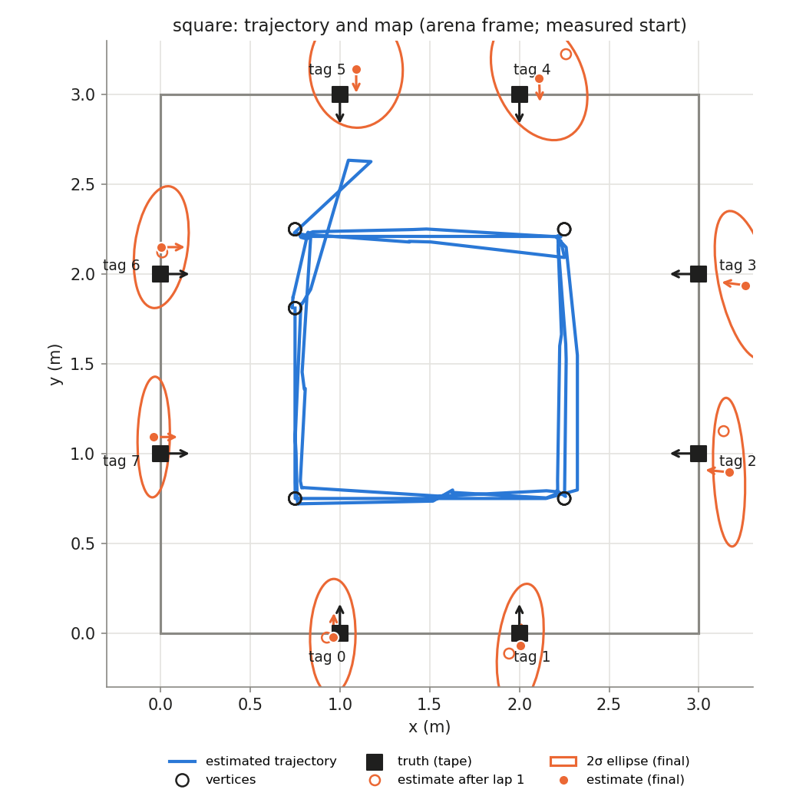
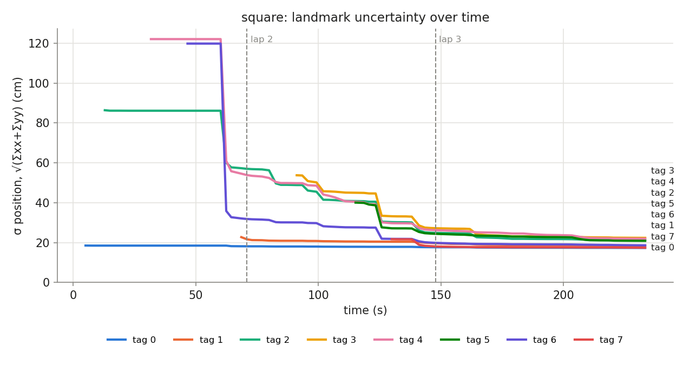

## Phase `square`

- vertices reached: 11/15; motion: 16.34 m driven, 1370° turned, 30 drives + 39 spins

### Final map vs truth

Placement in the arena: measured start (0.750, 1.810, -90.0°)

| tag | estimate (arena) | truth | 2σ ellipse (cm) | error, measured start (cm) | error, rigid fit (cm) | ψ error (°) |
|---|---|---|---|---|---|---|
| 0 | (0.960, -0.021, +87.2°) | (1.000, 0.000, +90.0°) | 32.2 × 12.6 | 4.5 | 8.3 | -2.8 |
| 1 | (2.005, -0.072, +87.1°) | (2.000, 0.000, +90.0°) | 34.8 × 12.5 | 7.2 | 7.6 | -2.9 |
| 2 | (3.168, 0.896, +174.7°) | (3.000, 1.000, +180.0°) | 41.4 × 8.8 | 19.8 | 13.7 | -5.3 |
| 3 | (3.258, 1.938, +172.9°) | (3.000, 2.000, +180.0°) | 42.3 × 14.4 | 26.6 | 16.5 | -7.1 |
| 4 | (2.110, 3.092, -88.0°) | (2.000, 3.000, -90.0°) | 36.5 × 24.3 | 14.4 | 9.9 | +2.0 |
| 5 | (1.091, 3.141, -89.8°) | (1.000, 3.000, -90.0°) | 32.6 × 26.0 | 16.8 | 10.7 | +0.2 |
| 6 | (0.005, 2.150, +0.1°) | (0.000, 2.000, +0.0°) | 34.2 × 14.7 | 15.0 | 10.4 | +0.1 |
| 7 | (-0.037, 1.092, +0.0°) | (0.000, 1.000, +0.0°) | 33.6 × 9.0 | 9.9 | 8.5 | +0.0 |

- **mean error, measured start: 14.3 cm** (rms 15.7, max 26.6 cm, mean |ψ| 2.6°)
- **mean error, best rigid fit: 10.7 cm** (rms 11.1, max 16.5 cm, mean |ψ| 2.6°)
- mean error after rigid fit **with scale**: 3.5 cm; the map is **1.065×** the truth (a uniform scale error, e.g. tag size or arena size)

### Lap by lap (lap 1 builds the map; later laps re-observe it)

| lap | landmarks | mean error (cm) | after rigid fit (cm) | mean σ (cm) | looks | update | init | gate | skip_init | mean d² |
|---|---|---|---|---|---|---|---|---|---|---|
| 1 | 5 | 17.1 | 15.4 | 36.5 | 25 | 9 | 5 | 0 | 10 | 0.99 |
| 2 | 8 | 13.0 | 11.6 | 22.2 | 28 | 36 | 3 | 0 | 9 | 1.09 |
| 3 | 8 | 14.3 | 10.7 | 19.8 | 31 | 52 | 0 | 0 | 0 | 0.70 |

### Landmark cases (new / out of view / re-appeared)

| tag | first added (t s, dist m, lap) | skip_init | updates | gated | re-appeared |
|---|---|---|---|---|---|
| 0 | 5.1, 1.10, lap 1 | 0 | 22 | 0 | 3 |
| 1 | 68.6, 2.26, lap 1 | 2 | 13 | 0 | 4 |
| 2 | 12.9, 2.42, lap 1 | 0 | 11 | 0 | 6 |
| 3 | 91.2, 2.05, lap 2 | 5 | 5 | 0 | 1 |
| 4 | 31.8, 1.69, lap 1 | 2 | 16 | 0 | 3 |
| 5 | 115.2, 2.05, lap 2 | 9 | 10 | 0 | 3 |
| 6 | 46.7, 1.64, lap 1 | 0 | 10 | 0 | 2 |
| 7 | 129.9, 1.82, lap 2 | 1 | 10 | 0 | 4 |
