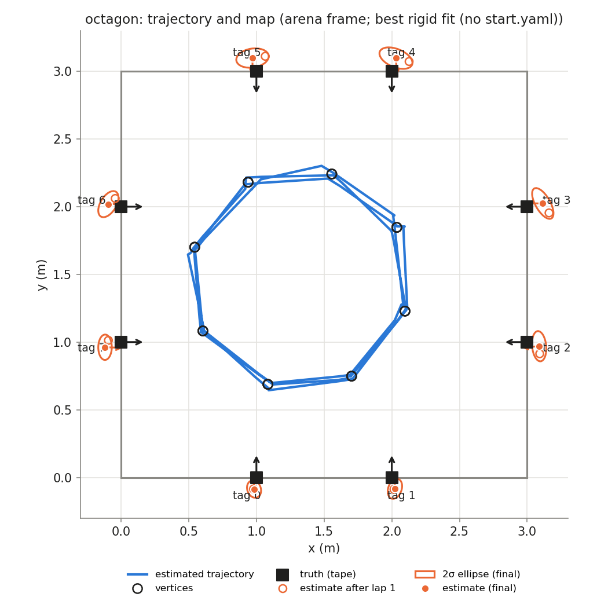
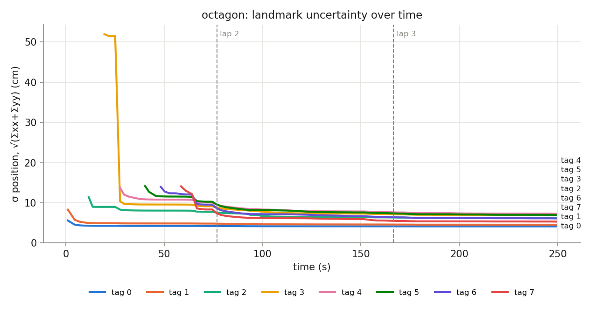

## Phase `octagon`

- vertices reached: 24/24; motion: 12.43 m driven, 1191° turned, 27 drives + 46 spins

### Final map vs truth

Placement in the arena: best rigid fit (no start.yaml) (0.544, 1.701, -84.4°)

| tag | estimate (arena) | truth | 2σ ellipse (cm) | error, measured start (cm) | error, rigid fit (cm) | ψ error (°) |
|---|---|---|---|---|---|---|
| 0 | (0.983, -0.086, +91.0°) | (1.000, 0.000, +90.0°) | 6.5 × 5.0 | — | 8.8 | +1.0 |
| 1 | (2.023, -0.083, +90.2°) | (2.000, 0.000, +90.0°) | 7.6 × 4.9 | — | 8.7 | +0.2 |
| 2 | (3.088, 0.970, -175.8°) | (3.000, 1.000, +180.0°) | 11.2 × 5.2 | — | 9.4 | +4.2 |
| 3 | (3.115, 2.024, +179.4°) | (3.000, 2.000, +180.0°) | 12.7 × 5.4 | — | 11.8 | -0.6 |
| 4 | (2.031, 3.097, -87.2°) | (2.000, 3.000, -90.0°) | 12.9 × 6.7 | — | 10.2 | +2.8 |
| 5 | (0.971, 3.098, -90.0°) | (1.000, 3.000, -90.0°) | 12.1 × 7.0 | — | 10.2 | -0.0 |
| 6 | (-0.093, 2.019, +1.1°) | (0.000, 2.000, +0.0°) | 10.7 × 5.9 | — | 9.5 | +1.1 |
| 7 | (-0.118, 0.962, -1.7°) | (0.000, 1.000, +0.0°) | 9.4 × 5.0 | — | 12.4 | -1.7 |

- **mean error, best rigid fit: 10.1 cm** (rms 10.2, max 12.4 cm, mean |ψ| 1.4°)
- mean error after rigid fit **with scale**: 1.2 cm; the map is **1.064×** the truth (a uniform scale error, e.g. tag size or arena size)

### Lap by lap (lap 1 builds the map; later laps re-observe it)

| lap | landmarks | mean error (cm) | after rigid fit (cm) | mean σ (cm) | looks | update | init | gate | skip_init | mean d² |
|---|---|---|---|---|---|---|---|---|---|---|
| 1 | 8 | — | 9.8 | 7.5 | 30 | 48 | 8 | 0 | 0 | 0.90 |
| 2 | 8 | — | 10.1 | 6.1 | 35 | 68 | 0 | 0 | 0 | 0.64 |
| 3 | 8 | — | 10.1 | 5.9 | 32 | 36 | 0 | 0 | 0 | 0.65 |

### Landmark cases (new / out of view / re-appeared)

| tag | first added (t s, dist m, lap) | skip_init | updates | gated | re-appeared |
|---|---|---|---|---|---|
| 0 | 1.0, 1.86, lap 1 | 0 | 25 | 0 | 5 |
| 1 | 1.0, 2.32, lap 1 | 0 | 24 | 0 | 4 |
| 2 | 11.6, 2.48, lap 1 | 0 | 8 | 0 | 5 |
| 3 | 19.6, 2.41, lap 1 | 0 | 17 | 0 | 3 |
| 4 | 27.6, 2.38, lap 1 | 0 | 18 | 0 | 4 |
| 5 | 40.3, 2.19, lap 1 | 0 | 22 | 0 | 6 |
| 6 | 48.3, 2.07, lap 1 | 0 | 20 | 0 | 4 |
| 7 | 58.5, 2.02, lap 1 | 0 | 18 | 0 | 5 |
