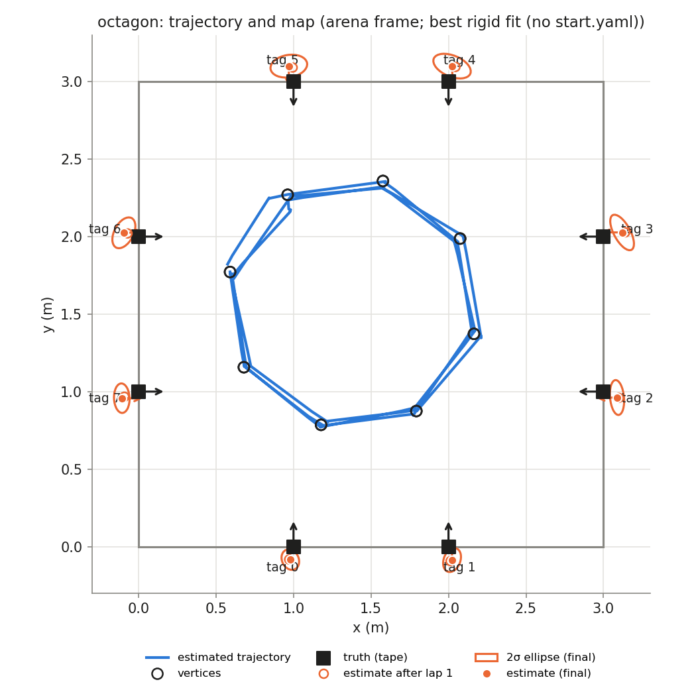
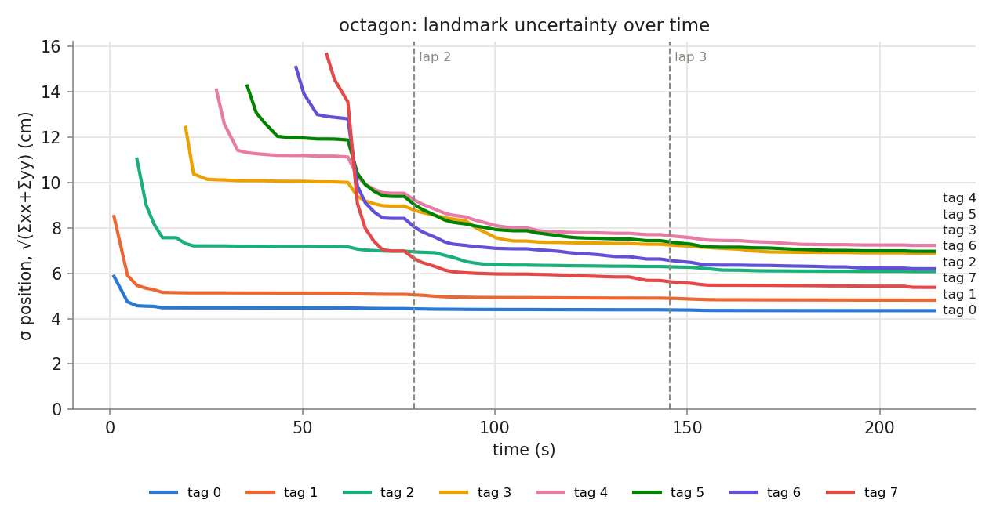

## Phase `octagon`

- vertices reached: 24/24; motion: 12.40 m driven, 1057° turned, 25 drives + 33 spins

### Final map vs truth

Placement in the arena: best rigid fit (no start.yaml) (0.591, 1.772, -81.7°)

| tag | estimate (arena) | truth | 2σ ellipse (cm) | error, measured start (cm) | error, rigid fit (cm) | ψ error (°) |
|---|---|---|---|---|---|---|
| 0 | (0.980, -0.084, +92.0°) | (1.000, 0.000, +90.0°) | 6.8 × 5.4 | — | 8.7 | +2.0 |
| 1 | (2.023, -0.087, +89.9°) | (2.000, 0.000, +90.0°) | 8.0 × 5.4 | — | 9.0 | -0.1 |
| 2 | (3.087, 0.962, -178.4°) | (3.000, 1.000, +180.0°) | 11.3 × 4.5 | — | 9.5 | +1.6 |
| 3 | (3.120, 2.027, +179.4°) | (3.000, 2.000, +180.0°) | 12.7 × 5.3 | — | 12.3 | -0.6 |
| 4 | (2.023, 3.100, -87.8°) | (2.000, 3.000, -90.0°) | 12.8 × 6.8 | — | 10.3 | +2.2 |
| 5 | (0.970, 3.100, -90.0°) | (1.000, 3.000, -90.0°) | 11.9 × 7.2 | — | 10.5 | +0.0 |
| 6 | (-0.095, 2.025, +1.3°) | (0.000, 2.000, +0.0°) | 10.7 × 6.2 | — | 9.8 | +1.3 |
| 7 | (-0.108, 0.958, -1.0°) | (0.000, 1.000, +0.0°) | 9.5 × 5.0 | — | 11.6 | -1.0 |

- **mean error, best rigid fit: 10.2 cm** (rms 10.3, max 12.3 cm, mean |ψ| 1.1°)
- mean error after rigid fit **with scale**: 1.2 cm; the map is **1.064×** the truth (a uniform scale error, e.g. tag size or arena size)

### Lap by lap (lap 1 builds the map; later laps re-observe it)

| lap | landmarks | mean error (cm) | after rigid fit (cm) | mean σ (cm) | looks | update | init | gate | skip_init | mean d² |
|---|---|---|---|---|---|---|---|---|---|---|
| 1 | 8 | — | 9.9 | 7.3 | 31 | 51 | 8 | 0 | 0 | 0.60 |
| 2 | 8 | — | 10.2 | 6.3 | 25 | 47 | 0 | 0 | 0 | 0.78 |
| 3 | 8 | — | 10.2 | 6.0 | 26 | 41 | 0 | 0 | 0 | 0.69 |

### Landmark cases (new / out of view / re-appeared)

| tag | first added (t s, dist m, lap) | skip_init | updates | gated | re-appeared |
|---|---|---|---|---|---|
| 0 | 1.0, 1.91, lap 1 | 0 | 18 | 0 | 6 |
| 1 | 1.0, 2.35, lap 1 | 0 | 18 | 0 | 2 |
| 2 | 7.0, 2.40, lap 1 | 0 | 15 | 0 | 4 |
| 3 | 19.6, 2.32, lap 1 | 0 | 17 | 0 | 2 |
| 4 | 27.6, 2.22, lap 1 | 0 | 17 | 0 | 3 |
| 5 | 35.6, 2.09, lap 1 | 0 | 20 | 0 | 2 |
| 6 | 48.3, 2.13, lap 1 | 0 | 17 | 0 | 4 |
| 7 | 56.3, 2.12, lap 1 | 0 | 17 | 0 | 4 |
