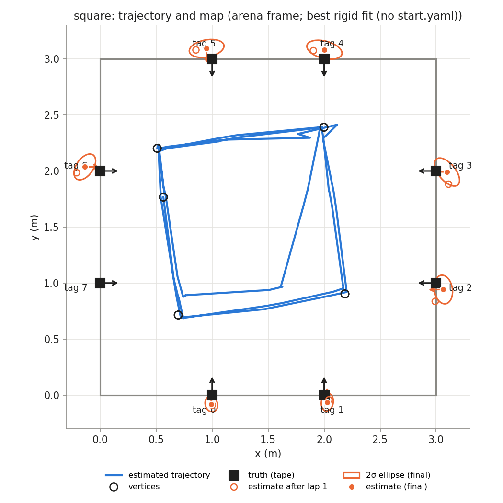
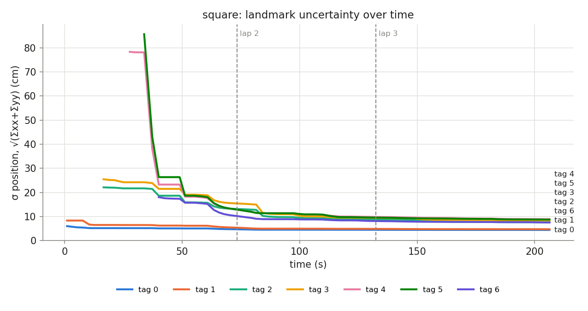

## Phase `square`

- vertices reached: 14/15; motion: 14.20 m driven, 1151° turned, 26 drives + 34 spins

### Final map vs truth

Placement in the arena: best rigid fit (no start.yaml) (0.565, 1.767, -82.8°)

| tag | estimate (arena) | truth | 2σ ellipse (cm) | error, measured start (cm) | error, rigid fit (cm) | ψ error (°) |
|---|---|---|---|---|---|---|
| 0 | (0.993, -0.081, +92.0°) | (1.000, 0.000, +90.0°) | 7.0 × 5.4 | — | 8.2 | +2.0 |
| 1 | (2.028, -0.064, +91.2°) | (2.000, 0.000, +90.0°) | 7.9 × 5.3 | — | 7.0 | +1.2 |
| 2 | (3.064, 0.942, -179.3°) | (3.000, 1.000, +180.0°) | 12.9 × 8.1 | — | 8.7 | +0.7 |
| 3 | (3.097, 1.991, +178.8°) | (3.000, 2.000, +180.0°) | 15.0 × 7.6 | — | 9.8 | -1.2 |
| 4 | (2.003, 3.083, -88.2°) | (2.000, 3.000, -90.0°) | 16.1 × 7.7 | — | 8.3 | +1.8 |
| 5 | (0.951, 3.094, -90.1°) | (1.000, 3.000, -90.0°) | 15.7 × 7.7 | — | 10.6 | -0.1 |
| 6 | (-0.136, 2.036, +0.4°) | (0.000, 2.000, +0.0°) | 13.0 × 7.5 | — | 14.1 | +0.4 |

- **mean error, best rigid fit: 9.5 cm** (rms 9.8, max 14.1 cm, mean |ψ| 1.1°)
- mean error after rigid fit **with scale**: 2.7 cm; the map is **1.060×** the truth (a uniform scale error, e.g. tag size or arena size)
- never mapped: [7]

### Lap by lap (lap 1 builds the map; later laps re-observe it)

| lap | landmarks | mean error (cm) | after rigid fit (cm) | mean σ (cm) | looks | update | init | gate | skip_init | mean d² |
|---|---|---|---|---|---|---|---|---|---|---|
| 1 | 7 | — | 12.7 | 10.7 | 27 | 34 | 7 | 0 | 10 | 0.85 |
| 2 | 7 | — | 9.2 | 7.9 | 21 | 35 | 0 | 0 | 5 | 0.85 |
| 3 | 7 | — | 9.5 | 7.2 | 27 | 45 | 0 | 0 | 6 | 0.58 |

### Landmark cases (new / out of view / re-appeared)

| tag | first added (t s, dist m, lap) | skip_init | updates | gated | re-appeared |
|---|---|---|---|---|---|
| 0 | 1.0, 1.94, lap 1 | 0 | 23 | 0 | 4 |
| 1 | 1.0, 2.32, lap 1 | 0 | 24 | 0 | 6 |
| 2 | 16.6, 1.45, lap 1 | 0 | 6 | 0 | 2 |
| 3 | 16.6, 1.93, lap 1 | 2 | 17 | 0 | 2 |
| 4 | 27.7, 2.25, lap 1 | 0 | 13 | 0 | 2 |
| 5 | 33.8, 1.81, lap 1 | 2 | 12 | 0 | 5 |
| 6 | 40.0, 2.17, lap 1 | 0 | 19 | 0 | 2 |
| 7 | never | 17 | 0 | 0 | 0 |
