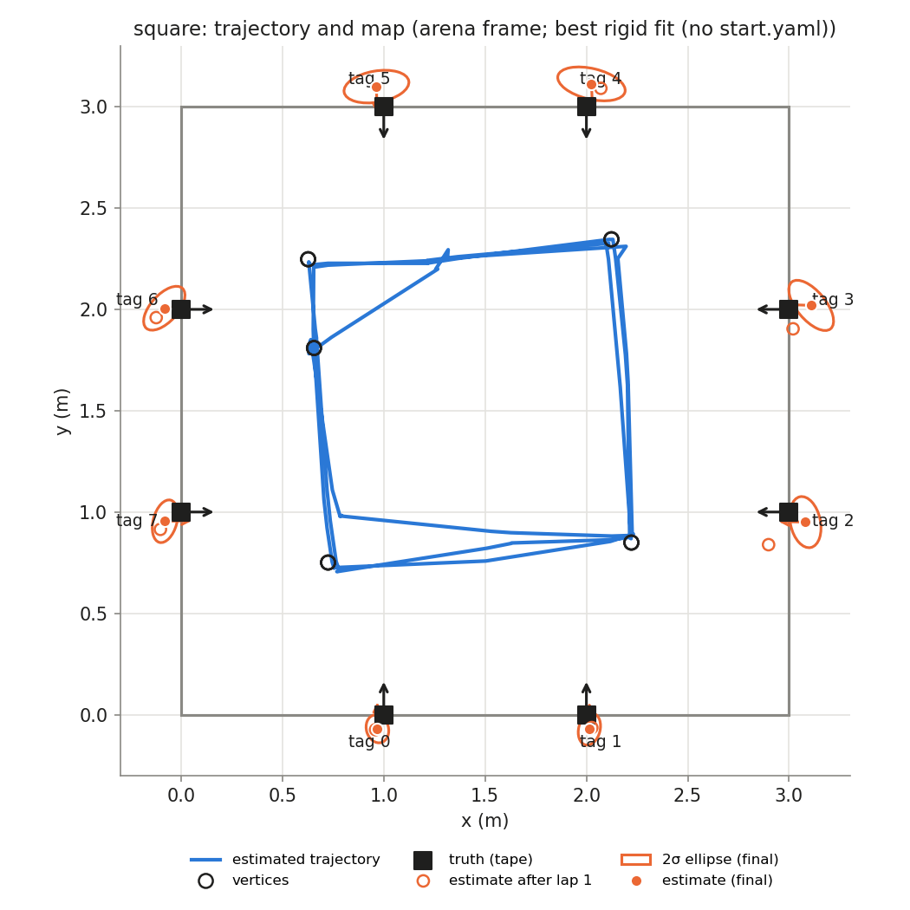
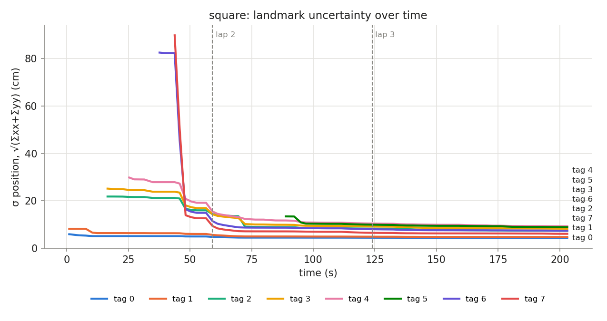

## Phase `square`

- vertices reached: 13/15; motion: 14.75 m driven, 1134° turned, 26 drives + 32 spins

### Final map vs truth

Placement in the arena: best rigid fit (no start.yaml) (0.656, 1.809, -86.2°)

| tag | estimate (arena) | truth | 2σ ellipse (cm) | error, measured start (cm) | error, rigid fit (cm) | ψ error (°) |
|---|---|---|---|---|---|---|
| 0 | (0.969, -0.070, +90.2°) | (1.000, 0.000, +90.0°) | 7.0 × 5.5 | — | 7.7 | +0.2 |
| 1 | (2.015, -0.071, +90.0°) | (2.000, 0.000, +90.0°) | 8.0 × 5.3 | — | 7.3 | -0.0 |
| 2 | (3.081, 0.950, +178.7°) | (3.000, 1.000, +180.0°) | 12.8 × 7.4 | — | 9.5 | -1.3 |
| 3 | (3.109, 2.020, +178.0°) | (3.000, 2.000, +180.0°) | 15.0 × 7.1 | — | 11.1 | -2.0 |
| 4 | (2.025, 3.113, -87.5°) | (2.000, 3.000, -90.0°) | 17.0 × 7.6 | — | 11.5 | +2.5 |
| 5 | (0.964, 3.099, -88.7°) | (1.000, 3.000, -90.0°) | 16.2 × 7.7 | — | 10.6 | +1.3 |
| 6 | (-0.083, 2.006, +1.7°) | (0.000, 2.000, +0.0°) | 13.3 × 6.7 | — | 8.3 | +1.7 |
| 7 | (-0.079, 0.954, +1.1°) | (0.000, 1.000, +0.0°) | 10.8 × 5.8 | — | 9.2 | +1.1 |

- **mean error, best rigid fit: 9.4 cm** (rms 9.5, max 11.5 cm, mean |ψ| 1.3°)
- mean error after rigid fit **with scale**: 2.0 cm; the map is **1.059×** the truth (a uniform scale error, e.g. tag size or arena size)

### Lap by lap (lap 1 builds the map; later laps re-observe it)

| lap | landmarks | mean error (cm) | after rigid fit (cm) | mean σ (cm) | looks | update | init | gate | skip_init | mean d² |
|---|---|---|---|---|---|---|---|---|---|---|
| 1 | 7 | — | 8.7 | 10.8 | 21 | 26 | 7 | 0 | 9 | 0.90 |
| 2 | 8 | — | 9.0 | 7.8 | 23 | 49 | 1 | 0 | 2 | 0.65 |
| 3 | 8 | — | 9.4 | 7.1 | 29 | 54 | 0 | 0 | 0 | 0.51 |

### Landmark cases (new / out of view / re-appeared)

| tag | first added (t s, dist m, lap) | skip_init | updates | gated | re-appeared |
|---|---|---|---|---|---|
| 0 | 1.0, 1.93, lap 1 | 0 | 21 | 0 | 4 |
| 1 | 1.0, 2.31, lap 1 | 0 | 23 | 0 | 6 |
| 2 | 16.6, 1.41, lap 1 | 0 | 7 | 0 | 4 |
| 3 | 16.6, 1.89, lap 1 | 2 | 15 | 0 | 4 |
| 4 | 25.3, 2.20, lap 1 | 0 | 13 | 0 | 2 |
| 5 | 88.8, 1.79, lap 2 | 7 | 9 | 0 | 3 |
| 6 | 37.6, 2.31, lap 1 | 0 | 19 | 0 | 2 |
| 7 | 43.8, 1.91, lap 1 | 2 | 22 | 0 | 4 |
