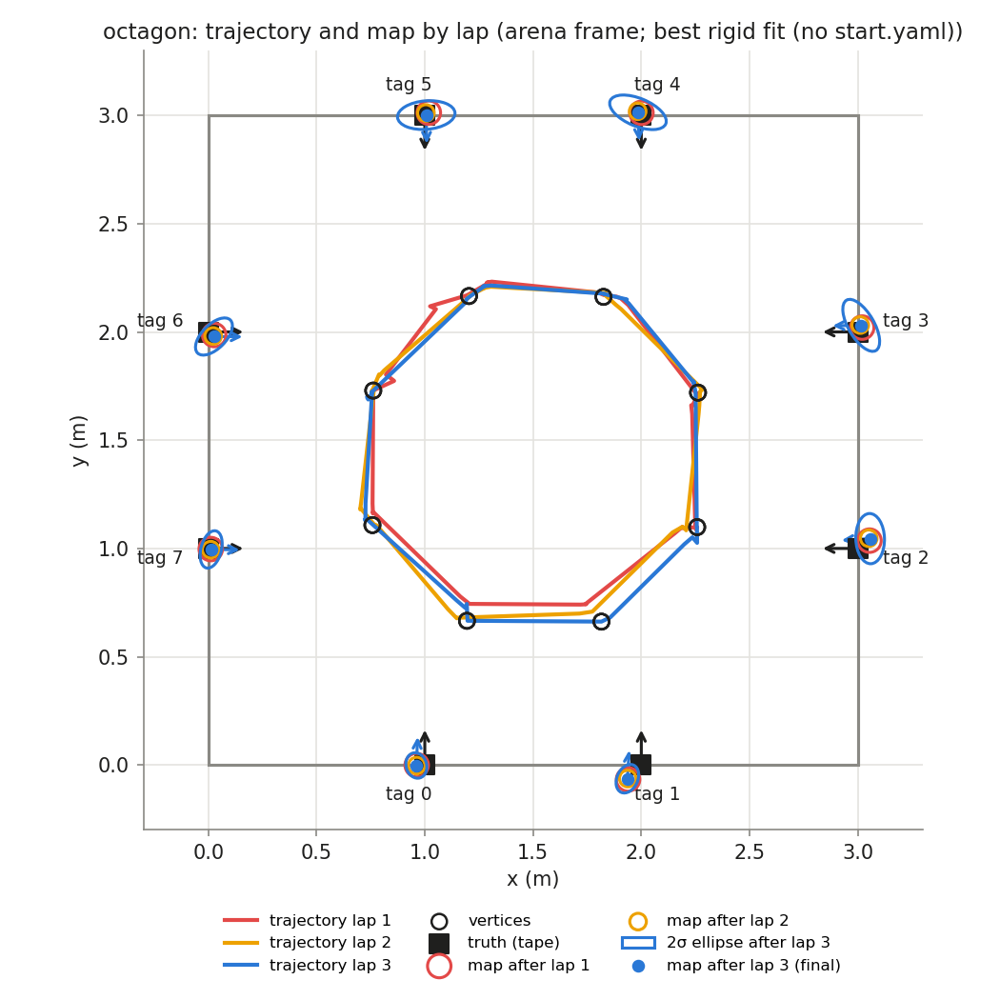
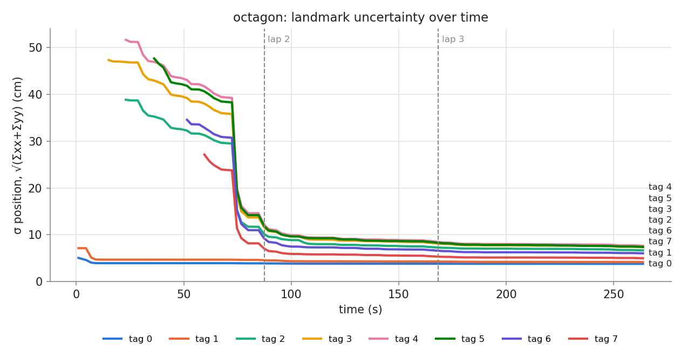

## Phase `octagon`

- vertices reached: 24/24; motion: 13.82 m driven, 1381° turned, 41 drives + 37 spins

### Final map vs truth

Placement in the arena: best rigid fit (no start.yaml) (0.762, 1.729, -90.4°)

| tag | estimate (arena) | truth | 2σ ellipse (cm) | error, measured start (cm) | error, rigid fit (cm) | ψ error (°) |
|---|---|---|---|---|---|---|
| 0 | (0.961, -0.002, +87.5°) | (1.000, 0.000, +90.0°) | 6.0 × 4.7 | — | 3.9 | -2.5 |
| 1 | (1.936, -0.064, +86.4°) | (2.000, 0.000, +90.0°) | 6.9 × 4.8 | — | 9.1 | -3.6 |
| 2 | (3.057, 1.045, -176.6°) | (3.000, 1.000, +180.0°) | 11.6 × 6.6 | — | 7.3 | +3.4 |
| 3 | (3.016, 2.030, -179.2°) | (3.000, 2.000, +180.0°) | 13.5 × 5.9 | — | 3.4 | +0.8 |
| 4 | (1.985, 3.014, -87.8°) | (2.000, 3.000, -90.0°) | 13.9 × 6.4 | — | 2.1 | +2.2 |
| 5 | (1.007, 3.002, -89.1°) | (1.000, 3.000, -90.0°) | 13.3 × 6.6 | — | 0.7 | +0.9 |
| 6 | (0.026, 1.979, -0.5°) | (0.000, 2.000, +0.0°) | 10.7 × 5.6 | — | 3.4 | -0.5 |
| 7 | (0.013, 0.995, -0.8°) | (0.000, 1.000, +0.0°) | 8.8 × 4.7 | — | 1.4 | -0.8 |

- **mean error, best rigid fit: 3.9 cm** (rms 4.7, max 9.1 cm, mean |ψ| 1.8°)
- mean error after rigid fit **with scale**: 4.0 cm; the map is **1.008×** the truth (a uniform scale error, e.g. tag size or arena size)

### Lap by lap (lap 1 builds the map; later laps re-observe it)

| lap | landmarks | mean error (cm) | after rigid fit (cm) | mean σ (cm) | looks | update | init | gate | skip_init | mean d² |
|---|---|---|---|---|---|---|---|---|---|---|
| 1 | 8 | — | 3.7 | 8.8 | 34 | 55 | 8 | 0 | 0 | 0.50 |
| 2 | 8 | — | 3.8 | 6.5 | 31 | 51 | 0 | 0 | 0 | 0.43 |
| 3 | 8 | — | 3.9 | 6.0 | 37 | 47 | 0 | 0 | 0 | 0.49 |

### Landmark cases (new / out of view / re-appeared)

| tag | first added (t s, dist m, lap) | skip_init | updates | gated | re-appeared |
|---|---|---|---|---|---|
| 0 | 1.0, 1.76, lap 1 | 0 | 25 | 0 | 6 |
| 1 | 1.0, 2.13, lap 1 | 0 | 16 | 0 | 7 |
| 2 | 23.1, 1.26, lap 1 | 0 | 3 | 0 | 1 |
| 3 | 15.1, 2.19, lap 1 | 0 | 17 | 0 | 4 |
| 4 | 23.1, 2.18, lap 1 | 0 | 20 | 0 | 4 |
| 5 | 36.3, 2.20, lap 1 | 0 | 20 | 0 | 5 |
| 6 | 51.5, 2.16, lap 1 | 0 | 24 | 0 | 5 |
| 7 | 59.6, 2.14, lap 1 | 0 | 28 | 0 | 5 |
