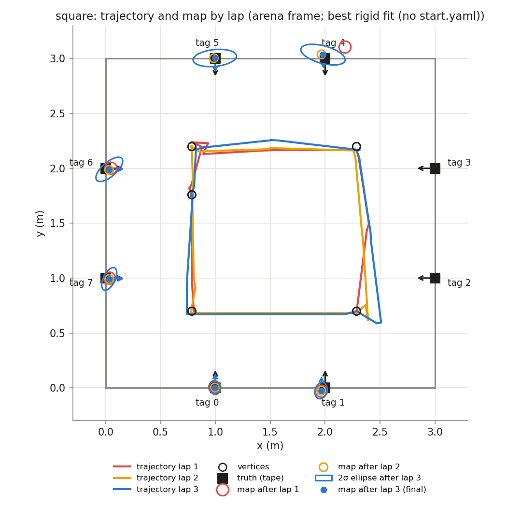
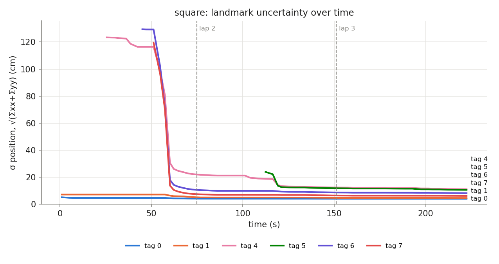

## Phase `square`

- vertices reached: 15/15; motion: 17.13 m driven, 1367° turned, 35 drives + 29 spins

### Final map vs truth

Placement in the arena: best rigid fit (no start.yaml) (0.786, 1.759, -90.0°)

| tag | estimate (arena) | truth | 2σ ellipse (cm) | error, measured start (cm) | error, rigid fit (cm) | ψ error (°) |
|---|---|---|---|---|---|---|
| 0 | (0.995, 0.003, +87.9°) | (1.000, 0.000, +90.0°) | 6.3 × 5.0 | — | 0.6 | -2.1 |
| 1 | (1.963, -0.026, +87.7°) | (2.000, 0.000, +90.0°) | 7.5 × 5.4 | — | 4.5 | -2.3 |
| 4 | (1.981, 3.035, -87.2°) | (2.000, 3.000, -90.0°) | 20.8 × 8.0 | — | 4.0 | +2.8 |
| 5 | (0.995, 3.005, -87.8°) | (1.000, 3.000, -90.0°) | 19.9 × 7.7 | — | 0.7 | +2.2 |
| 6 | (0.034, 1.990, +0.6°) | (0.000, 2.000, +0.0°) | 15.1 × 6.5 | — | 3.5 | +0.6 |
| 7 | (0.033, 0.992, +0.4°) | (0.000, 1.000, +0.0°) | 11.2 × 5.4 | — | 3.4 | +0.4 |

- **mean error, best rigid fit: 2.8 cm** (rms 3.2, max 4.5 cm, mean |ψ| 1.7°)
- mean error after rigid fit **with scale**: 2.8 cm; the map is **0.998×** the truth (a uniform scale error, e.g. tag size or arena size)
- never mapped: [2, 3]

### Lap by lap (lap 1 builds the map; later laps re-observe it)

| lap | landmarks | mean error (cm) | after rigid fit (cm) | mean σ (cm) | looks | update | init | gate | skip_init | mean d² |
|---|---|---|---|---|---|---|---|---|---|---|
| 1 | 5 | — | 6.1 | 9.9 | 27 | 28 | 5 | 0 | 11 | 0.40 |
| 2 | 6 | — | 2.9 | 8.0 | 27 | 38 | 1 | 0 | 4 | 0.58 |
| 3 | 6 | — | 2.8 | 7.5 | 25 | 37 | 0 | 0 | 2 | 0.30 |

### Landmark cases (new / out of view / re-appeared)

| tag | first added (t s, dist m, lap) | skip_init | updates | gated | re-appeared |
|---|---|---|---|---|---|
| 0 | 1.0, 1.78, lap 1 | 0 | 29 | 0 | 3 |
| 1 | 1.0, 2.14, lap 1 | 0 | 17 | 0 | 6 |
| 3 | never | 6 | 0 | 0 | 0 |
| 4 | 25.6, 2.40, lap 1 | 0 | 16 | 0 | 2 |
| 5 | 112.4, 2.15, lap 2 | 9 | 9 | 0 | 2 |
| 6 | 45.0, 2.44, lap 1 | 0 | 13 | 0 | 2 |
| 7 | 51.2, 1.98, lap 1 | 2 | 19 | 0 | 8 |
