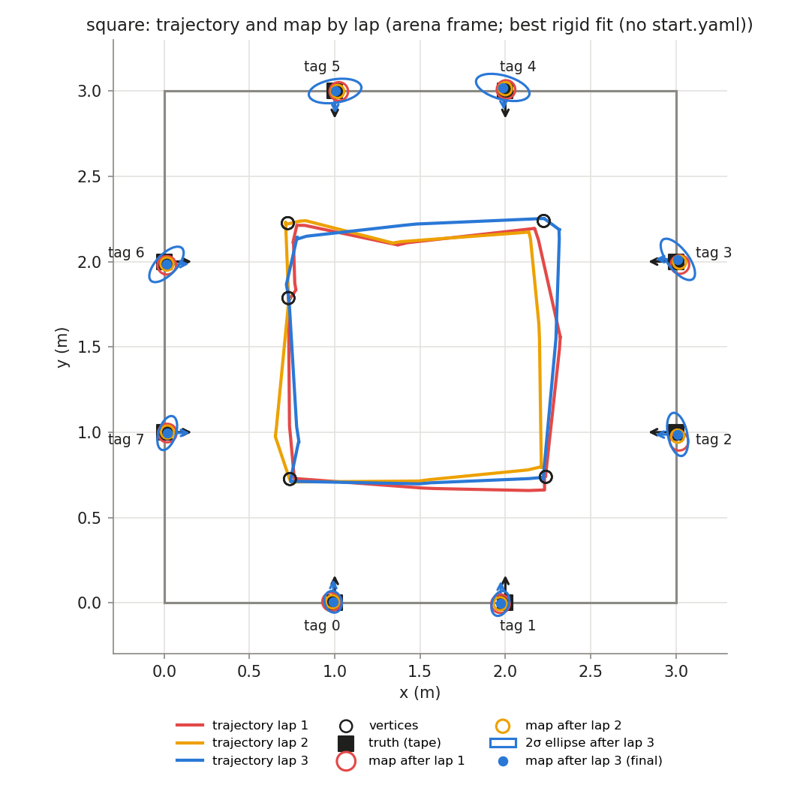
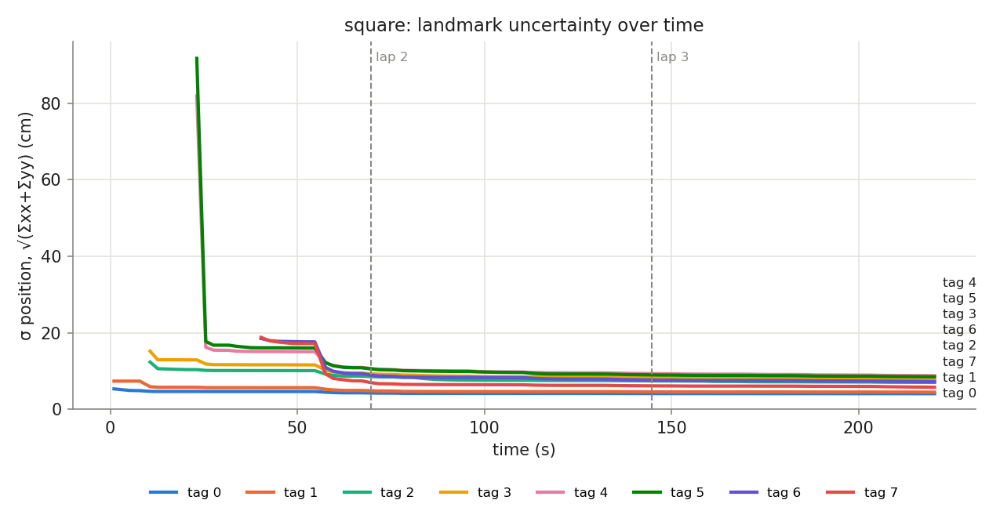
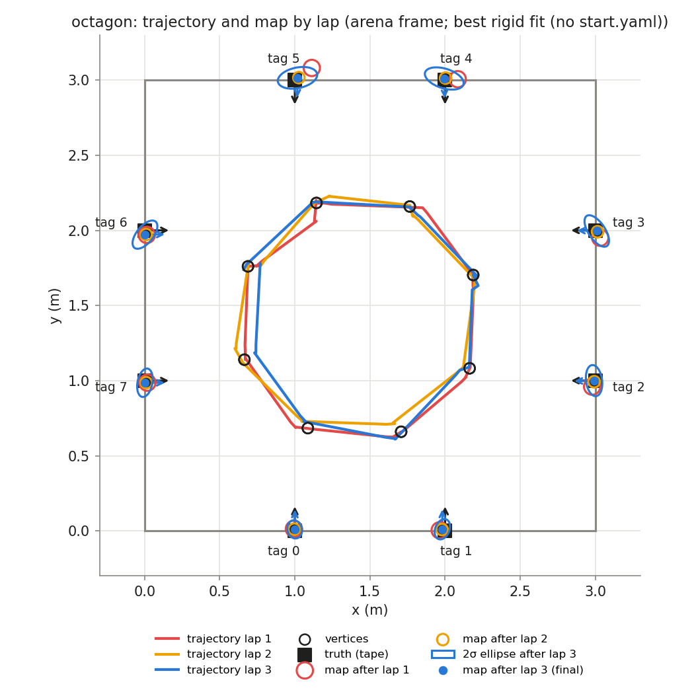
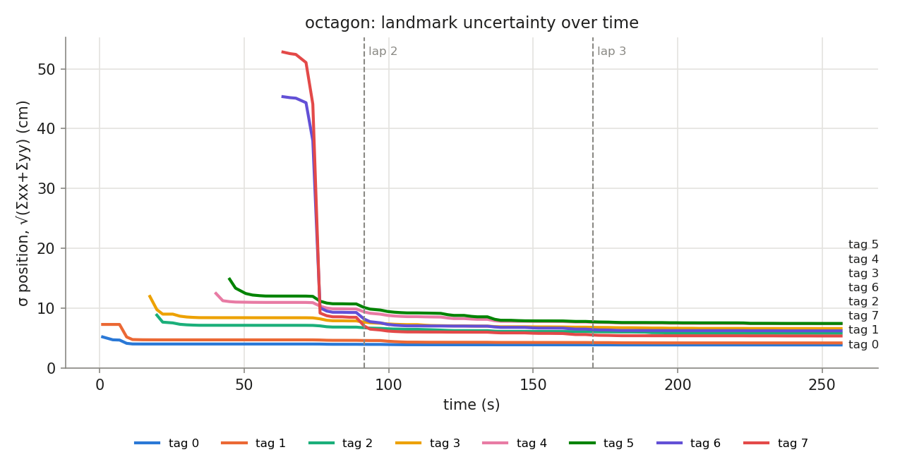

# HW3 run `run_20261107_001535`

## Phase `square`

- vertices reached: 15/15; motion: 16.08 m driven, 1360° turned, 33 drives + 31 spins

### Final map vs truth

Placement in the arena: best rigid fit (no start.yaml) (0.729, 1.786, -89.5°)

| tag | estimate (arena) | truth | 2σ ellipse (cm) | error, measured start (cm) | error, rigid fit (cm) | ψ error (°) |
|---|---|---|---|---|---|---|
| 0 | (0.990, 0.006, +89.1°) | (1.000, 0.000, +90.0°) | 6.4 × 5.0 | — | 1.2 | -0.9 |
| 1 | (1.971, -0.004, +88.7°) | (2.000, 0.000, +90.0°) | 7.5 × 4.9 | — | 3.0 | -1.3 |
| 2 | (3.009, 0.987, -179.2°) | (3.000, 1.000, +180.0°) | 12.9 × 5.7 | — | 1.6 | +0.8 |
| 3 | (3.011, 2.013, +179.2°) | (3.000, 2.000, +180.0°) | 14.5 × 6.2 | — | 1.7 | -0.8 |
| 4 | (1.985, 3.021, -87.1°) | (2.000, 3.000, -90.0°) | 16.1 × 7.0 | — | 2.6 | +2.9 |
| 5 | (1.002, 3.000, -89.4°) | (1.000, 3.000, -90.0°) | 15.6 × 6.8 | — | 0.2 | +0.6 |
| 6 | (0.014, 1.983, +1.3°) | (0.000, 2.000, +0.0°) | 13.2 × 6.0 | — | 2.2 | +1.3 |
| 7 | (0.018, 0.995, +0.5°) | (0.000, 1.000, +0.0°) | 10.4 × 5.1 | — | 1.9 | +0.5 |

- **mean error, best rigid fit: 1.8 cm** (rms 1.9, max 3.0 cm, mean |ψ| 1.1°)
- mean error after rigid fit **with scale**: 1.8 cm; the map is **1.000×** the truth (a uniform scale error, e.g. tag size or arena size)

### Lap by lap (lap 1 builds the map; later laps re-observe it)

| lap | landmarks | mean error (cm) | after rigid fit (cm) | mean σ (cm) | looks | update | init | gate | skip_init | mean d² |
|---|---|---|---|---|---|---|---|---|---|---|
| 1 | 8 | — | 2.1 | 8.0 | 25 | 41 | 8 | 0 | 0 | 0.51 |
| 2 | 8 | — | 1.7 | 7.1 | 27 | 53 | 0 | 0 | 0 | 0.49 |
| 3 | 8 | — | 1.8 | 6.7 | 27 | 52 | 0 | 0 | 0 | 0.45 |

### Landmark cases (new / out of view / re-appeared)

| tag | first added (t s, dist m, lap) | skip_init | updates | gated | re-appeared |
|---|---|---|---|---|---|
| 0 | 1.0, 1.81, lap 1 | 0 | 26 | 0 | 4 |
| 1 | 1.0, 2.17, lap 1 | 0 | 19 | 0 | 7 |
| 2 | 10.7, 2.25, lap 1 | 0 | 10 | 0 | 3 |
| 3 | 10.7, 2.58, lap 1 | 0 | 16 | 0 | 5 |
| 4 | 23.1, 2.38, lap 1 | 0 | 15 | 0 | 3 |
| 5 | 23.1, 2.67, lap 1 | 0 | 19 | 0 | 5 |
| 6 | 40.3, 2.15, lap 1 | 0 | 19 | 0 | 3 |
| 7 | 40.3, 2.44, lap 1 | 0 | 22 | 0 | 7 |

## Phase `octagon`

- vertices reached: 24/24; motion: 13.88 m driven, 1282° turned, 41 drives + 34 spins

### Final map vs truth

Placement in the arena: best rigid fit (no start.yaml) (0.688, 1.760, -92.2°)

| tag | estimate (arena) | truth | 2σ ellipse (cm) | error, measured start (cm) | error, rigid fit (cm) | ψ error (°) |
|---|---|---|---|---|---|---|
| 0 | (0.999, 0.010, +89.2°) | (1.000, 0.000, +90.0°) | 6.1 × 4.8 | — | 1.0 | -0.8 |
| 1 | (1.982, 0.011, +90.3°) | (2.000, 0.000, +90.0°) | 7.0 × 4.7 | — | 2.1 | +0.3 |
| 2 | (2.992, 1.000, -178.6°) | (3.000, 1.000, +180.0°) | 10.4 × 5.3 | — | 0.8 | +1.4 |
| 3 | (3.010, 1.996, +178.4°) | (3.000, 2.000, +180.0°) | 12.1 × 5.6 | — | 1.0 | -1.6 |
| 4 | (1.995, 3.011, -88.6°) | (2.000, 3.000, -90.0°) | 13.4 × 6.5 | — | 1.2 | +1.4 |
| 5 | (1.018, 3.015, -90.7°) | (1.000, 3.000, -90.0°) | 13.3 × 6.8 | — | 2.3 | -0.7 |
| 6 | (0.003, 1.971, +0.7°) | (0.000, 2.000, +0.0°) | 11.2 × 5.5 | — | 2.9 | +0.7 |
| 7 | (0.002, 0.986, -0.0°) | (0.000, 1.000, +0.0°) | 9.6 × 4.9 | — | 1.4 | -0.0 |

- **mean error, best rigid fit: 1.6 cm** (rms 1.8, max 2.9 cm, mean |ψ| 0.8°)
- mean error after rigid fit **with scale**: 1.6 cm; the map is **0.999×** the truth (a uniform scale error, e.g. tag size or arena size)

### Lap by lap (lap 1 builds the map; later laps re-observe it)

| lap | landmarks | mean error (cm) | after rigid fit (cm) | mean σ (cm) | looks | update | init | gate | skip_init | mean d² |
|---|---|---|---|---|---|---|---|---|---|---|
| 1 | 8 | — | 3.9 | 7.2 | 36 | 57 | 8 | 0 | 1 | 0.37 |
| 2 | 8 | — | 1.8 | 6.1 | 30 | 61 | 0 | 0 | 0 | 0.81 |
| 3 | 8 | — | 1.6 | 5.9 | 33 | 37 | 0 | 0 | 0 | 0.66 |

### Landmark cases (new / out of view / re-appeared)

| tag | first added (t s, dist m, lap) | skip_init | updates | gated | re-appeared |
|---|---|---|---|---|---|
| 0 | 1.0, 1.79, lap 1 | 0 | 19 | 0 | 4 |
| 1 | 1.0, 2.16, lap 1 | 0 | 19 | 0 | 5 |
| 2 | 19.8, 1.91, lap 1 | 0 | 14 | 0 | 4 |
| 3 | 17.4, 2.39, lap 1 | 0 | 22 | 0 | 6 |
| 4 | 40.2, 2.00, lap 1 | 0 | 21 | 0 | 7 |
| 5 | 45.0, 2.26, lap 1 | 0 | 17 | 0 | 4 |
| 6 | 63.4, 1.85, lap 1 | 0 | 22 | 0 | 8 |
| 7 | 63.4, 2.18, lap 1 | 1 | 21 | 0 | 6 |

## Square vs octagon (final maps)

| phase | laps | landmarks | mean error (cm) | after rigid fit (cm) | with scale (cm) | map / truth | lap 1 error (cm) | mean σ lap 1 → last (cm) | drive (m) | turns |
|---|---|---|---|---|---|---|---|---|---|---|
| square | 3 | 8 | — | 1.8 | 1.8 | 1.000 | — | 8.0 → 6.7 | 16.1 | 31 |
| octagon | 3 | 8 | — | 1.6 | 1.6 | 0.999 | — | 7.2 → 5.9 | 13.9 | 34 |
