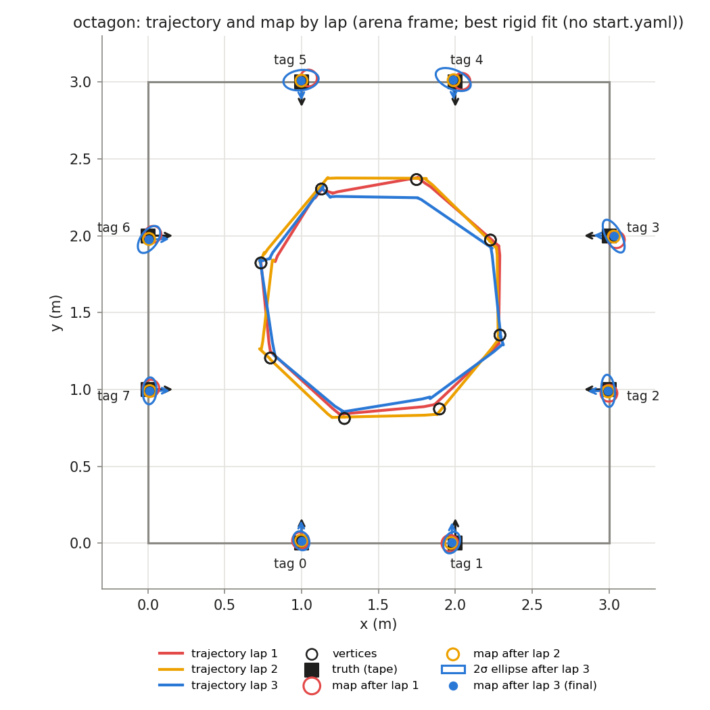
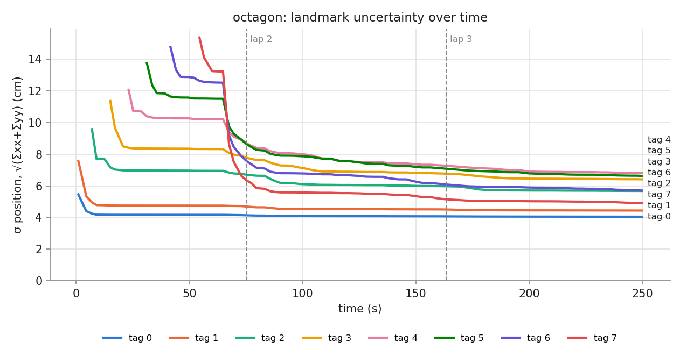

## Phase `octagon`

- vertices reached: 24/24; motion: 13.63 m driven, 1342° turned, 37 drives + 35 spins

### Final map vs truth

Placement in the arena: best rigid fit (no start.yaml) (0.736, 1.822, -84.3°)

| tag | estimate (arena) | truth | 2σ ellipse (cm) | error, measured start (cm) | error, rigid fit (cm) | ψ error (°) |
|---|---|---|---|---|---|---|
| 0 | (0.998, 0.015, +90.4°) | (1.000, 0.000, +90.0°) | 6.4 × 5.0 | — | 1.6 | +0.4 |
| 1 | (1.976, 0.004, +89.1°) | (2.000, 0.000, +90.0°) | 7.3 × 5.0 | — | 2.4 | -0.9 |
| 2 | (2.994, 0.991, -179.0°) | (3.000, 1.000, +180.0°) | 10.5 × 4.3 | — | 1.1 | +1.0 |
| 3 | (3.030, 1.997, +177.5°) | (3.000, 2.000, +180.0°) | 11.8 × 4.9 | — | 3.0 | -2.5 |
| 4 | (1.986, 3.016, -88.7°) | (2.000, 3.000, -90.0°) | 12.1 × 6.3 | — | 2.1 | +1.3 |
| 5 | (0.996, 3.012, -88.8°) | (1.000, 3.000, -90.0°) | 11.5 × 6.6 | — | 1.2 | +1.2 |
| 6 | (0.007, 1.975, +1.4°) | (0.000, 2.000, +0.0°) | 10.0 × 5.5 | — | 2.6 | +1.4 |
| 7 | (0.011, 0.991, +0.5°) | (0.000, 1.000, +0.0°) | 8.7 × 4.5 | — | 1.5 | +0.5 |

- **mean error, best rigid fit: 1.9 cm** (rms 2.0, max 3.0 cm, mean |ψ| 1.1°)
- mean error after rigid fit **with scale**: 1.9 cm; the map is **1.000×** the truth (a uniform scale error, e.g. tag size or arena size)

### Lap by lap (lap 1 builds the map; later laps re-observe it)

| lap | landmarks | mean error (cm) | after rigid fit (cm) | mean σ (cm) | looks | update | init | gate | skip_init | mean d² |
|---|---|---|---|---|---|---|---|---|---|---|
| 1 | 8 | — | 1.7 | 6.8 | 29 | 45 | 8 | 0 | 0 | 0.53 |
| 2 | 8 | — | 1.9 | 5.9 | 34 | 68 | 0 | 0 | 0 | 0.53 |
| 3 | 8 | — | 1.9 | 5.6 | 33 | 59 | 0 | 0 | 0 | 0.59 |

### Landmark cases (new / out of view / re-appeared)

| tag | first added (t s, dist m, lap) | skip_init | updates | gated | re-appeared |
|---|---|---|---|---|---|
| 0 | 1.0, 1.83, lap 1 | 0 | 25 | 0 | 5 |
| 1 | 1.0, 2.20, lap 1 | 0 | 18 | 0 | 4 |
| 2 | 7.0, 2.20, lap 1 | 0 | 17 | 0 | 5 |
| 3 | 15.1, 2.14, lap 1 | 0 | 19 | 0 | 2 |
| 4 | 23.2, 2.07, lap 1 | 0 | 23 | 0 | 6 |
| 5 | 31.3, 2.12, lap 1 | 0 | 27 | 0 | 5 |
| 6 | 41.7, 2.21, lap 1 | 0 | 23 | 0 | 7 |
| 7 | 54.5, 2.17, lap 1 | 0 | 20 | 0 | 6 |
