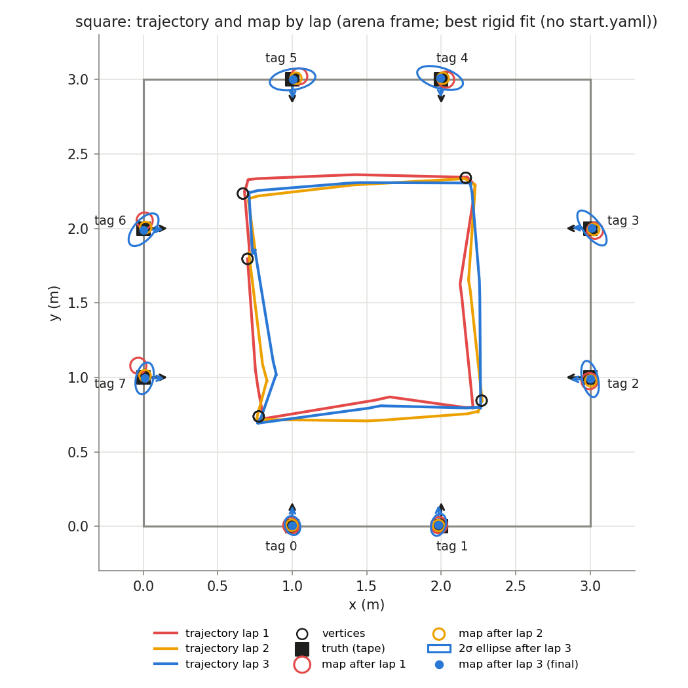
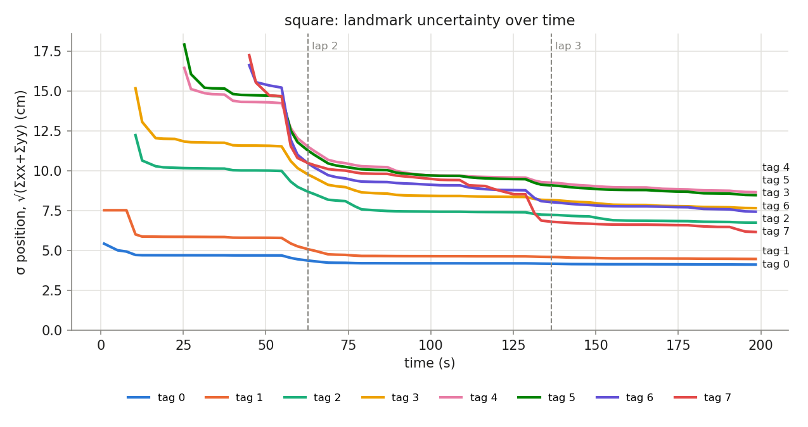

## Phase `square`

- vertices reached: 15/15; motion: 16.17 m driven, 1365° turned, 30 drives + 24 spins

### Final map vs truth

Placement in the arena: best rigid fit (no start.yaml) (0.700, 1.795, -85.9°)

| tag | estimate (arena) | truth | 2σ ellipse (cm) | error, measured start (cm) | error, rigid fit (cm) | ψ error (°) |
|---|---|---|---|---|---|---|
| 0 | (1.002, 0.005, +90.5°) | (1.000, 0.000, +90.0°) | 6.5 × 5.1 | — | 0.5 | +0.5 |
| 1 | (1.982, 0.010, +90.0°) | (2.000, 0.000, +90.0°) | 7.5 × 4.8 | — | 2.1 | +0.0 |
| 2 | (2.999, 0.989, -178.0°) | (3.000, 1.000, +180.0°) | 12.4 × 5.3 | — | 1.1 | +2.0 |
| 3 | (3.012, 2.003, +179.0°) | (3.000, 2.000, +180.0°) | 14.2 × 5.8 | — | 1.2 | -1.0 |
| 4 | (1.992, 3.010, -87.4°) | (2.000, 3.000, -90.0°) | 15.9 × 6.9 | — | 1.2 | +2.6 |
| 5 | (1.002, 3.000, -89.4°) | (1.000, 3.000, -90.0°) | 15.4 × 7.0 | — | 0.2 | +0.6 |
| 6 | (0.002, 1.991, +1.1°) | (0.000, 2.000, +0.0°) | 13.3 × 6.6 | — | 0.9 | +1.1 |
| 7 | (0.009, 0.993, +0.3°) | (0.000, 1.000, +0.0°) | 10.9 × 5.8 | — | 1.1 | +0.3 |

- **mean error, best rigid fit: 1.0 cm** (rms 1.2, max 2.1 cm, mean |ψ| 1.0°)
- mean error after rigid fit **with scale**: 1.0 cm; the map is **0.999×** the truth (a uniform scale error, e.g. tag size or arena size)

### Lap by lap (lap 1 builds the map; later laps re-observe it)

| lap | landmarks | mean error (cm) | after rigid fit (cm) | mean σ (cm) | looks | update | init | gate | skip_init | mean d² |
|---|---|---|---|---|---|---|---|---|---|---|
| 1 | 8 | — | 1.6 | 9.0 | 22 | 35 | 8 | 0 | 0 | 0.67 |
| 2 | 8 | — | 0.9 | 7.2 | 26 | 56 | 0 | 0 | 0 | 0.59 |
| 3 | 8 | — | 1.0 | 6.7 | 21 | 45 | 0 | 0 | 0 | 0.66 |

### Landmark cases (new / out of view / re-appeared)

| tag | first added (t s, dist m, lap) | skip_init | updates | gated | re-appeared |
|---|---|---|---|---|---|
| 0 | 1.0, 1.83, lap 1 | 0 | 19 | 0 | 3 |
| 1 | 1.0, 2.20, lap 1 | 0 | 20 | 0 | 6 |
| 2 | 10.5, 2.21, lap 1 | 0 | 14 | 0 | 2 |
| 3 | 10.5, 2.56, lap 1 | 0 | 18 | 0 | 5 |
| 4 | 25.3, 2.25, lap 1 | 0 | 18 | 0 | 2 |
| 5 | 25.3, 2.55, lap 1 | 0 | 20 | 0 | 6 |
| 6 | 45.0, 2.16, lap 1 | 0 | 14 | 0 | 2 |
| 7 | 45.0, 2.52, lap 1 | 0 | 13 | 0 | 5 |
